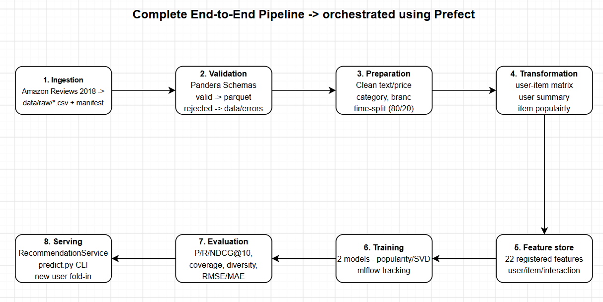

# Recommendation Pipeline - Data Management for Machine Learning (Assignment 2)

**Author:** Govind Satwani  |  **Roll No.:** 2025AG05056

This repository contains an end-to-end pipeline for a product recommender trained on the **Amazon Reviews 2018 - Software (5-core)** dataset (J. McAuley lab, UCSD). 
The pipeline ingests raw reviews and product metadata, validates them, prepares and transforms them, builds a feature layer, trains and evaluates two recommenders.
The entire pipeline is orchestrated end to end with Prefect.



## Stages and where to find them

| Stage | Code | Main outputs |
|---|---|---|
| 1. Ingestion | `src/ingestion/ingest.py` | `data/raw/users.csv`, `data/raw/items.csv`, `data/raw/interactions.csv`, `data/raw/ingestion_manifest.json` |
| 2. Validation | `src/validation/validate.py`, `fault_injection.py` | `data/processed/validated/*.parquet`, `data/errors/*_errors.csv`, `reports/validation_report*.md` |
| 3. Preparation | `src/preparation/prepare.py` | `*_clean.parquet`, `train.parquet`, `test.parquet`, `split_info.json` |
| 4. Transformation | `src/transformation/transform.py` | `user_item_matrix.npz`, `user_activity_summary.parquet`, `item_popularity.parquet` |
| 5. Feature management | `src/features/` | `data/features/*.parquet`, `reports/feature_catalog.md` |
| 6. Training | `src/training/` | `models/*.joblib`, MLflow runs |
| 7. Evaluation | `src/evaluation/` | `reports/model_comparison.md`, `reports/model_comparison.csv`, `reports/model_comparison.json` |
| 8. Orchestration | `dags/recsys_flow.py`) | task run states in the console / Prefect UI, `logs/pipeline.log` |
| Serving | `src/inference/`, `predict.py` | `reports/sample_recommendations.md` |

Models: **popularity baseline** and **SVD matrix factorisation** (personalised). 
1. The full write-up can be found in [`reports/final_report.md`](reports/final_report.md).
2. The feature documentation can be found in [`reports/feature_catalog.md`](reports/feature_catalog.md).

## Setup

1. **Python 3.14** on Linux has been used for the code.
2. The pinned versions in `requirements.txt` are the tested set.
3. The first run requires the dataset to be downloaded (size ~20MB) - hence the first run takes 3-4 minutes to download the dataset.
4. Subsequent runs use the cached version of the dataset, and start processing the data instantly.

### Command to set up the environment and install all dependencies and libraries
```bash
python3 -m venv .venv
.venv/bin/pip install -r requirements.txt
```

## Single command to run the whole pipeline

```bash
export MLFLOW_DISABLE_AGENT_HINT=1
.venv/bin/python dags/recsys_flow.py
```

The flow runs: ingest -> validate -> prepare -> transform -> features -> train popularity / SVD models -> evaluate -> demo recommendations.
Runs are deterministic (seed 42): two consecutive runs give identical metrics.

The code is also capable of scheduled execution. Prefect only fires schedules against a real server, so start `prefect server start` first and serve the flow against it (sample scheduled execution at 2:00 AM):

```bash
.venv/bin/prefect server start  # execute on terminal 1
PREFECT_API_URL=http://127.0.0.1:4200/api .venv/bin/python dags/recsys_flow.py --serve "0 2 * * *"  # execute on terminal 2
```

UIs:

```bash
.venv/bin/mlflow server --backend-store-uri sqlite:///mlflow.db --port 5000   # http://127.0.0.1:5000 -> experiment "software-recommender"
.venv/bin/prefect server start       # http://127.0.0.1:4200 -> then run the flow with PREFECT_API_URL=http://127.0.0.1:4200/api
```

Individual stages of the pipeline can also be run on their own:

```bash
.venv/bin/python -m src.ingestion.ingest
.venv/bin/python -m src.validation.validate
.venv/bin/python -m src.preparation.prepare
.venv/bin/python -m src.transformation.transform
.venv/bin/python -m src.features.feature_store
.venv/bin/python -m src.training.train
.venv/bin/python -m src.evaluation.evaluate
.venv/bin/python -m src.inference.demo
```

## Get recommendations for a user

```bash
# existing user (uses the reviews seen in training)
.venv/bin/python predict.py --user_id A2THQCHKR89E16 --k 10 --show-history

# brand-new user: pass their reviews as item_id:rating (fold-in, no retraining)
.venv/bin/python predict.py --history "B00004TYCR:5,B00003JAU7:4" --k 5

# unknown user without reviews -> popularity fallback
.venv/bin/python predict.py --user_id SOMEONE_NEW
```

Choose the model with `--model {popularity,svd}` (default model is `svd`).

## Project layout

```
configs/config.yaml - all parameters used throughout the process
dags/recsys_flow.py - Complete Prefect flow
src/ - ingestion, validation, preparation, transformation, features, training, evaluation, inference
data/{raw,processed,features,errors}
models/
reports/
docs/
predict.py - CLI recommender
```

## Notes and limitations

* Evaluation is offline (time-based 80/20 split, K=10, relevant = rating >= 4). No live A/B test is being done.
* The dataset is small and sparse (density ~0.8%); about half of the test interactions involve items that were never seen in training and cannot be recommended by collaborative models.
* The user table only holds an id and name; whereas the user attributes are derived from interaction history.
* Large or regenerated artefacts are git-ignored and rebuilt by the pipeline: `data/raw/items.csv` and the downloaded `.gz` files, `data/processed/`, `data/features/`, `models/*.joblib`, `mlflow.db`/`mlartifacts/` and `logs/`.
* The small raw CSVs, the error datasets (`data/errors/`) and all generated reports (`reports/`) are committed for visibility in the operation of the pipeline.
