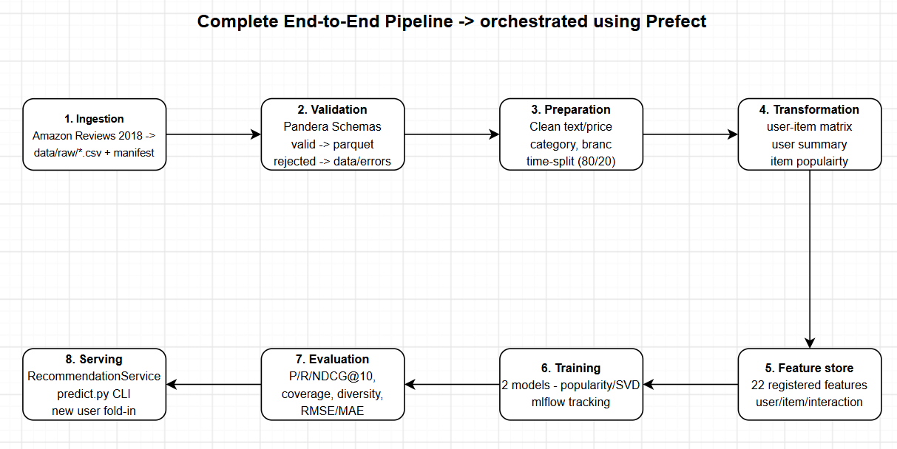

# Final Report: End-to-End Data Management Pipeline for a Recommendation System

**Name:** Govind Satwani  
**Roll number:** 2025AG05056  
**Course:** Data Management for Machine Learning   
**GitHub repository:** https://github.com/govindsatwani/recommendation-pipeline

## 1. Objective and Dataset

The objective of this project was to build a modular, reproducible data management pipeline for a recommendation system.  
The pipeline covers data ingestion, validation, preparation, transformation, feature management, model training, evaluation, and orchestration.  
The project uses the public **Amazon Reviews 2018 — Software (5-core)** dataset and its associated product metadata from the McAuley Lab.  
The reviews provide user-item interactions and ratings, while the metadata provides item attributes.  
The pipeline derives three tables: users, items, and interactions.

## 2. Architecture and Tools

The workflow is:  
`Ingestion → Validation → Preparation → Transformation → Feature Management → Training → Evaluation → Recommendation Generation`  

The pipeline is implemented in Python and orchestrated using **Prefect**.  
It uses Pandas for data processing, Pandera for validation, Parquet and CSV for data storage, scikit-learn for truncated SVD, and MLflow for experiment tracking.  
Separate modules are used for each stage to make the workflow easier to inspect and maintain.



## 3. Data Ingestion and Validation

The ingestion stage reads the review and metadata files and creates the user, item, and interaction tables.  
It also generates an ingestion manifest with row counts, columns, and SHA-256 hashes for provenance.  

The validation stage checks missing values, duplicates, data types, rating ranges, timestamps, and referential integrity between interactions and the user and item tables.  
Rejected records are saved in error datasets with reasons, and the results are recorded in a validation report.  
A separate fault-injection demonstration applies the checks to deliberately corrupted input.

| Dataset | Input rows | Valid rows | Rejected rows |
|---|---:|---:|---:|
| Users | 1,826 | 1,826 | 0 |
| Items | 26,790 | 21,639 | 5,151 |
| Interactions | 12,805 | 11,984 | 821 |

## 4. Preparation, Transformation, and Features

Preparation cleans and standardizes text and item attributes, parses and imputes prices, handles missing values, and resolves repeated user-item interactions.  
A chronological split separates older training interactions from later test interactions. For the reported run, the cutoff was **2015-09-30**, with **9,505 training rows** and **2,379 test rows**.

Transformation produces user activity summaries, an item popularity table, a sparse user-item interaction matrix, and user and item index mappings.

The custom feature layer defines **22 features**: eight user features, nine item features, and five interaction features.  Examples include user average rating and activity count, item popularity and average rating, recency, preferred category, and category match. The feature catalog documents their definitions and sources.

The current models use only a subset of these features. Interaction features are materialized for potential downstream use but are not directly used in the current ranking models.

## 5. Model Training and Evaluation

Two recommenders were trained:

1. **Popularity baseline:** ranks items by their number of training interactions.
2. **Personalized SVD recommender:** uses truncated matrix factorization over the user-item interaction matrix to generate personalized rankings.

MLflow records model parameters, metrics, and artifacts. Evaluation uses **K = 10**, with a test rating of at least 4 treated as relevant. Previously seen training items are excluded from recommendation lists.

The ranking evaluation covers **311 users** with training history and at least one relevant future item in the training catalog. RMSE and MAE are calculated on **710 test interactions** whose users and items are both known from training. Thus, these metrics do not represent every test interaction.

| Model | Precision@10 | Recall@10 | NDCG@10 | Coverage | Diversity | RMSE | MAE |
|---|---:|---:|---:|---:|---:|---:|---:|
| Popularity | 0.0058 | 0.0233 | 0.0138 | 0.0208 | 0.8536 | 1.3752 | 1.1192 |
| SVD | 0.0161 | 0.1046 | 0.0703 | 0.3781 | 0.8037 | 1.1953 | 0.9637 |

On this offline evaluation subset, SVD performs better on precision, recall, NDCG, coverage, RMSE, and MAE. The popularity baseline has higher intra-list diversity.

## 6. Orchestration and Reproducibility

Prefect runs the pipeline stages in dependency order and records their execution states. The repository includes setup instructions, pinned dependencies, configuration, reports, and a workflow that can be run once or served on a schedule.

After creating the Python environment and installing dependencies as described in the README, the complete pipeline can be run with:

```bash
.venv/bin/python dags/recsys_flow.py
```

## 7. Limitations

The following limitations were seen in the current execution of the code:
* Evaluation is offline and excludes test interactions involving users or items absent from training. Cold-start performance is  therefore not fully represented by the reported metrics.
* The interaction data is sparse, and no online A/B test was performed.
* Repeated user-item interactions are currently deduplicated before the time split. Consequently, a later interaction can cause an earlier interaction for the same pair to be removed from training.
* The comparison uses one popularity baseline and one personalized model, and extensive hyperparameter tuning was not performed.

## 8. Future Improvements

Possible future improvements include:
* time-safe handling of repeated interactions
* separate cold-start evaluation
* integrating a hybrid model that incorporates item attributes into ranking